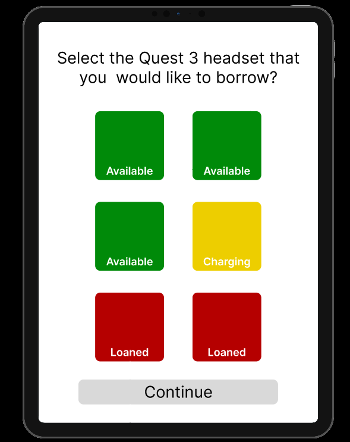
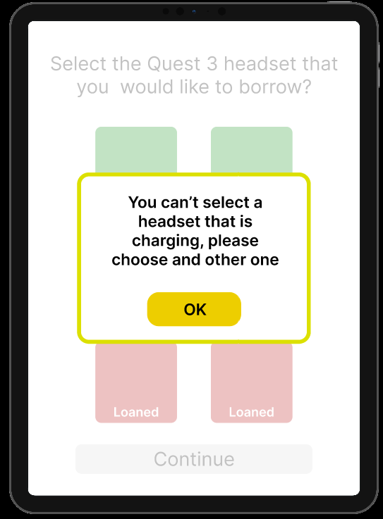
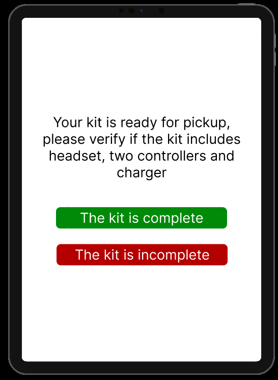

# Design Justification

## 1. Interaction Decisions
Below, 3 design decisions made for the Kiosk project will be explained.

### Interaction 1: Traffic light colors
-   **User problem:** Students need to quickly identify which Quest 3s are available to request without having to read too much text.
-   **HCI Principle:** Visibility of system status / availability.
-   **Design solution:** Colors were implemented based on a traffic light (Green = Available, Yellow = Charging, Red = Borrowed). This allows users to process availability instantly through already existing mental colors like those of a traffic light, visually guiding them toward selecting the green equipment (available) for a faster checkout.
-   **Evidence:**
    *   

### Interaction 2: User selection
-   **User problem:** If a user tries to select a Quest that is not available (charging or borrowed), they need to clearly understand why they cannot take it and how to proceed.
-   **HCI Principle:** Help users recognize.
-   **Design solution:** The system blocks the selection of yellow or red Quests. When attempting it, a text warning is displayed explaining the reason why that Quest is not available. Likewise, it is aided by visual colors, since they are the same as when you choose a Quest. 
-   **Evidence:** 
    *   

### Interaction 3: Kit verification
-   **User problem:** Since the process is automated and there is no staff supervising, students do not want to be held responsible if they open a Quest and notice that the previous user lost a part of the Quest kit.
-   **HCI Principle:** Error prevention.
-   **Design solution:** A mandatory pause in the process was implemented through a verification screen. Before lending the kit, the system forces the student to confirm that the box contains the headset, the two controllers, and the charger. If the kit is incomplete, the interface offers an apology message and allows the user to choose a different piece of equipment, thus avoiding unfair responsibility being assumed.
-   **Evidence:** 
    *   

## 2. Figma vs Unity Comparison
Here we analyze the changes made between Figma and Unity. Four modifications were made:

-   **Change 1: Incorporation of images** Quest images were added to the kit selection interface, instead of relying solely on colors or text.
-   **Justification:** This improves it by showing the real object, reduces cognitive load, and makes the interface more intuitive and visually appealing. 

-   **Change 2: 3x2 Layout** The grid changed from a 2x3 vertical format to a 3x2 horizontal one.
-   **Justification:** This is due to implementation requirements. The 3-column by 2-row layout makes much better use of the visual space in Unity, preventing the interface from looking cramped.

-   **Change 3: Removal of the "Continue" button in the selection** The "Continue" button was removed from the first screen, so now, upon tapping an available Quest, the system advances directly.
-   **Justification:** Eliminating an unnecessary click speeds up the checkout process, making the interaction more direct.

-   **Change 4: Addition of a "Reset" button** A reset button was integrated that was not originally in the Figma prototype.
-   **Justification:** This responds to a technical need. It is necessary to reset the test scenarios and allows the kiosk to quickly return to its OG state if a user abandons the section halfway through the process.